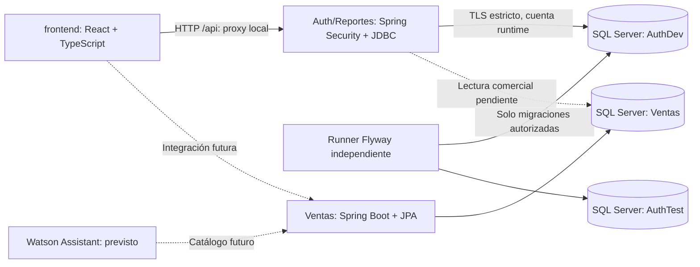
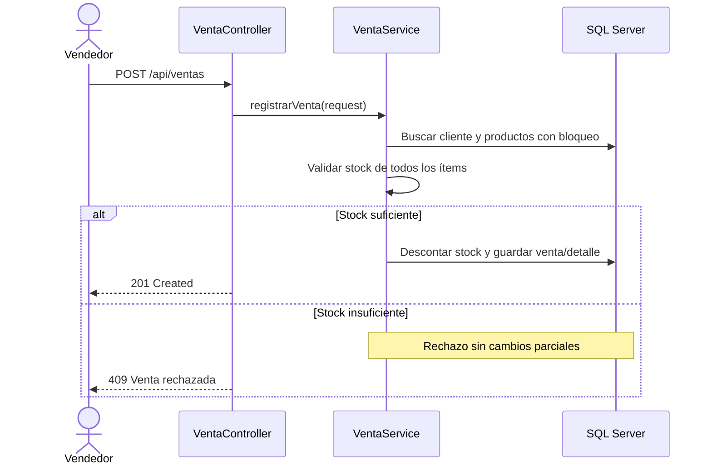

# FerreStock — Sistema de Gestión para Ferreterías

Proyecto **EFSRT — Cibertec**. FerreStock busca reemplazar cuadernos y hojas de cálculo por una gestión organizada de inventario, ventas y accesos del equipo. El objetivo es reducir quiebres de stock, registrar ventas con descuento transaccional y ofrecer información comercial y consultas de catálogo.

**Estado: en desarrollo.** Auth y el frontend funcionan en el entorno local aprovisionado. Los reportes comerciales requieren todavía el esquema y contrato aprobados de Ventas. El proyecto completo no está desplegado ni validado en producción.

## Contenido

- [Estado funcional y roles](#estado-funcional-y-roles)
- [Arquitectura y tecnologías](#arquitectura-y-tecnologías)
- [Preparar el entorno local](#preparar-el-entorno-local)
- [Arranque recomendado](#arranque-recomendado)
- [Acceso y comprobaciones](#acceso-y-comprobaciones)
- [Pruebas y evidencias](#pruebas-y-evidencias)
- [Ventas y habilitación de reportes](#ventas-y-habilitación-de-reportes)
- [Solución de problemas](#solución-de-problemas)
- [Roadmap y documentación](#roadmap-y-documentación)

## Estado funcional y roles

| Módulo | Implementación y estado real |
| --- | --- |
| Auth y usuarios | Funcional en local: login/logout, sesiones opacas, roles, creación y gestión de usuarios, cambio administrado de contraseñas, activación/desactivación, revocación de sesiones y protección del último administrador activo |
| Frontend compartido | React con login, dashboard por rol, usuarios, perfil y Reportes; navegación responsive, estados de carga/error y comprobaciones automatizadas de accesibilidad básica |
| Reportes | Backend, contratos, interfaz y generación JSON/PDF/XLSX implementados; **sin habilitación comercial real**. Ventas por período, productos más vendidos y stock bajo mantienen HTTP 503 cuando falta el contrato comercial |
| Ventas | API y lógica transaccional implementadas en código; pruebas unitarias disponibles. Despliegue del esquema comercial e integración con Auth/frontend pendientes de validación conjunta |
| Inventario | Modelo Producto y consulta de stock en Ventas; módulo completo de entradas, salidas y ajustes pendiente |
| Clientes | Entidad y repositorio en Ventas; gestión completa e interfaz pendientes |
| Chatbot | Objetivo académico: catálogo, disponibilidad y precios con Watson Assistant; sin integración implementada verificada |
| Azure | Objetivo de despliegue; sin evidencia actual de una entrega productiva |

Roles del MVP de Auth:

| Rol | Acceso actual al frontend |
| --- | --- |
| `ADMINISTRADOR` | Usuarios, operaciones administrativas de cuentas, perfil y opciones de Reportes; los datos comerciales siguen pendientes |
| `VENDEDOR` | Vista general y perfil; futura integración de registro de ventas y consulta comercial |
| `ALMACENERO` | Vista general y perfil; futuras operaciones de inventario |

El backend verifica siempre la autorización real. El rol Cliente del planteamiento académico se reserva para consulta de catálogo/chatbot; **no se requieren cuentas de clientes en el MVP actual**. La administración de productos y precios es un objetivo comercial, no un permiso ya integrado en estas pantallas.

## Arquitectura y tecnologías

El repositorio contiene dos aplicaciones Spring Boot independientes y un frontend compartido. Cada backend utiliza capas de controladores, servicios y repositorios; no existe un POM agregador ni una dependencia de compilación de Auth hacia Ventas.



```text
ferrestock/
├── README.md
├── frontend/                    # Aplicación compartida React/TypeScript/Vite
│   ├── src/                     # Auth, usuarios, perfil y reportes
│   ├── e2e/                     # Navegador con API aislada
│   └── docs/                    # Informes públicos de UX
├── auth-reportes-service/       # Spring Boot, Security y JDBC
│   ├── src/main/resources/db/migration/  # V1/V2 de Auth
│   ├── db/provisioning/         # Procedimientos SQL: revisión administrativa separada
│   ├── tools/db-runner/         # CLI Flyway independiente del runtime
│   └── tools/local-runtime/     # Arranque local Windows y parada de procesos propios
└── ventas-service/              # Spring Boot, JPA y lógica transaccional
    └── src/                    # controller, dto, entity, exception, repository, service
```

Versiones declaradas en los archivos del repositorio:

| Área | Tecnología |
| --- | --- |
| Backend | Java 21; Spring Boot **4.1.1** en ambos POM; Spring Security y Spring JDBC en Auth; Spring Data JPA, Bean Validation y Lombok en Ventas |
| Persistencia | SQL Server 2022; driver Microsoft JDBC; Flyway en el runner separado, sin migraciones automáticas al iniciar Auth |
| Exportación | PDFBox 3.0.8 y Apache POI 5.5.1 |
| Frontend | React 19.3.1, TypeScript 7.0.2, Vite 8.3.4 y React Router 7.18.4 |
| Pruebas frontend | Vitest 5.0.5, Testing Library y Playwright 1.64.1 |
| Herramientas | Maven Wrapper 3.3.4 con Maven 3.9.16; Node.js >=22.12.0; PowerShell 5.1+ para el lanzador Windows; Docker Desktop para SQL local |

## Preparar el entorno local

### Requisitos

Instalar Git, JDK 21 y Node.js compatible, con `JAVA_HOME`/PATH correctos. Maven se obtiene mediante el wrapper; la primera preparación requiere acceso a los repositorios de dependencias. Docker Desktop debe estar disponible si se usa el SQL Server local existente.

```powershell
java -version
node --version
npm.cmd --version
docker --version
$PSVersionTable.PSVersion
```

Para el **entorno Auth ya aprovisionado**, el responsable debe proporcionar acceso al contenedor existente, JKS externo aprobado con su contraseña original y credencial runtime SQL vigente. Los secretos no se incluyen en Git. Este README no sustituye el procedimiento de primera instalación.

### Obtener el código

Desde el directorio donde se guardarán los proyectos:

```powershell
git clone --branch feature/auth-reportes-service https://github.com/MichaelLunaDev/ferrestock.git
cd ferrestock
```

Los comandos siguientes indican su directorio de trabajo. No ejecutar comandos Maven de Ventas para preparar Auth.

### Comprobar SQL existente

Entorno local de referencia: contenedor `ferrestock-mssql`, SQL Server 2022, conexión `127.0.0.1:14333`, bases `ferrestock_auth_dev`, `ferrestock_auth_test` y `ferrestock_ventas`. AuthTest/AuthDev tienen V1/V2 aplicadas y TLS estricto configurado según la evidencia operativa anterior.

```powershell
docker ps --filter "name=ferrestock-mssql"
Test-NetConnection 127.0.0.1 -Port 14333
```

`docker ps` confirma ejecución y puertos; TCP disponible **no demuestra autenticación SQL ni validación TLS**. Si el contenedor está detenido, coordinar su arranque con el responsable del SQL compartido y Ventas; no recrearlo ni reiniciarlo rutinariamente.

No hay un paso cotidiano `docker run`: la instalación existente conserva volumen y configuración TLS propios. Una máquina nueva necesita aprovisionamiento independiente revisado y autorizado, incluido el JKS; clonar el repositorio no copia las bases, certificados o cuentas. Los scripts existentes están en [db/provisioning](auth-reportes-service/db/provisioning/); no ejecutarlos como onboarding automático.

### Preparar Auth/Reportes

Desde la raíz del repositorio, cuando falten las clases o el classpath local:

```powershell
cd auth-reportes-service
.\mvnw.cmd -B test
.\mvnw.cmd -B dependency:build-classpath '-Dmdep.outputFile=target/local-runtime-classpath.txt'
cd ..
```

`test` compila y ejecuta las pruebas unitarias con `auth-unit`, fijado por Surefire. No activa el perfil Maven de integración SQL ni ejecuta Flyway o bootstrap. El segundo comando genera el classpath utilizado por el lanzador. Se utiliza `test` para preparar clases sin reemplazar un JAR que pueda estar en uso en Windows.

El runtime real utiliza exclusivamente `auth-db` con destino AuthDev e identidad `ferrestock_auth_app`. `auth-integration` corresponde a AuthTest y su cuenta independiente; no mezclar estos perfiles con `auth-unit`. El lanzador establece el perfil y destino cerrados, por lo que no hace falta introducir manualmente URLs o secretos en comandos.

### Preparar React

Desde la raíz, solo para instalar o reconstruir dependencias según el lockfile:

```powershell
cd frontend
npm.cmd ci
cd ..
```

No es necesario repetir `npm ci` en cada arranque. Para trabajar únicamente con Vite, desde `frontend/`:

```powershell
npm.cmd run dev
```

Vite escucha en `127.0.0.1:5173`; `/api` se dirige a `http://127.0.0.1:8081`. El frontend por sí solo no proporciona login SQL real. Este arranque manual es alternativo al lanzador integrado; no iniciar dos servidores en el mismo puerto.

## Arranque recomendado

Desde la raíz del repositorio, usar el [lanzador local Windows](auth-reportes-service/tools/local-runtime/Start-Local.ps1).

Primero, comprobar disponibilidad sin iniciar componentes:

```powershell
powershell.exe -NoProfile -ExecutionPolicy RemoteSigned -File ".\auth-reportes-service\tools\local-runtime\Start-Local.ps1" -Check
```

| Campo | Significado |
| --- | --- |
| `BackendHealth` | El endpoint 8081 devuelve HTTP 200, servicio esperado y estado UP |
| `FrontendProxy` | La ruta 5173/api/health devuelve el mismo contrato esperado |
| `ReadOnly` | La operación de comprobación no inicia ni detiene procesos |
| `SqlOperations` | 0: el helper no realiza consultas ni cambios SQL en esta comprobación |

`-Check` no instala ni levanta la aplicación; health no acredita por sí solo una conexión SQL autenticada o la integración comercial.

Para iniciar los componentes ausentes:

```powershell
powershell.exe -NoProfile -ExecutionPolicy RemoteSigned -File ".\auth-reportes-service\tools\local-runtime\Start-Local.ps1"
```

- Si backend y proxy ya responden correctamente, se reutilizan sin reiniciarlos. La comprobación de identidad es el contrato HTTP esperado, no una atestación completa del proceso.
- Si un puerto está ocupado por un servicio que no supera la comprobación, se bloquea; no mata procesos desconocidos.
- Si falta backend, exige clases/classpath y conexión TCP a SQL. Pide la **ruta absoluta del JKS externo existente**, su contraseña **original** y la contraseña SQL **actual de `ferrestock_auth_app`** mediante entrada oculta. No solicita sa, migrador ni la contraseña del administrador de la aplicación.
- Si falta frontend, exige las dependencias de Vite e inicia el wrapper Node existente con `/api`. No entrega las credenciales SQL/JKS a Vite.
- No ejecuta migraciones, bootstrap, cambios de permisos ni reinicio de SQL Server. El arranque Auth sí realiza las comprobaciones JDBC de identidad propias del perfil SQL.

El lanzador usa `LocalRuntime` en loopback 8081, perfil `auth-db`, cifrado requerido y validación de certificado. Los secretos se entregan temporalmente mediante el entorno del proceso Java hijo; no se escriben en argumentos, archivos versionados ni logs del lanzador. Esto no constituye protección absoluta frente a inspección privilegiada del sistema operativo. No compartir credenciales por chat ni guardar material TLS en el repositorio.

Mantener abierta la consola si creó procesos. **Enter solicita parada ordenada solo de esos procesos** mediante su entrada estándar. Si no se confirma la parada, muestra una advertencia sin forzarla. Los procesos que ya existían no se detienen. El helper descarta la salida de los procesos hijos para evitar exponer mensajes sensibles; un bloqueo puede requerir diagnóstico acotado del responsable.

Es una herramienta local, no un servicio Windows permanente ni un despliegue de producción. La evidencia anterior cubre reutilización de servicios, protocolo de parada y procesos de prueba propios; no se reinició el backend aceptado solo para certificar un ciclo nuevo completo.

## Acceso y comprobaciones

| Servicio local | URL |
| --- | --- |
| React | http://127.0.0.1:5173/ |
| Backend health | http://127.0.0.1:8081/api/health |
| Health vía proxy | http://127.0.0.1:5173/api/health |

Desde otra consola, lecturas HTTP sin credenciales:

```powershell
curl.exe http://127.0.0.1:8081/api/health
curl.exe http://127.0.0.1:5173/api/health
```

Ambos deben devolver HTTP 200 y este objeto JSON, sin depender del orden de sus propiedades:

```json
{"status":"UP","service":"auth-reportes-service"}
```

Health confirma atención HTTP, no salud de la base ni disponibilidad de los reportes. Usar `curl.exe` en Windows para distinguirlo del alias PowerShell `curl`.

Para ingresar: abrir React, introducir la cuenta **de aplicación previamente creada** y su contraseña, y acceder al dashboard. ADMINISTRADOR gestiona usuarios; los demás roles ven sus opciones autorizadas. Usar **Salir** para cerrar sesión. Los cambios de rol, estado o credenciales revocan sesiones y el backend impide dejar al sistema sin administrador activo.

El token opaco se conserva **solo en memoria**; recargar puede devolver al login. No hay persistencia en localStorage/sessionStorage ni recuperación autónoma de contraseña: solicitar el restablecimiento al administrador. No volver a ejecutar bootstrap para ingresar o arrancar.

## Pruebas y evidencias

Comandos offline de desarrollo, desde `auth-reportes-service/`:

```powershell
.\mvnw.cmd -B test
.\mvnw.cmd -B -f tools/db-runner/pom.xml verify
```

El primero ejecuta pruebas unitarias; el segundo compila y verifica el runner independiente con dobles JDBC/Flyway, **sin ejecutar migraciones**. El perfil Maven `auth-sql-integration` y sus AuthSqlIT no son parte del onboarding cotidiano. El plugin Flyway del POM principal permanece separado y bloqueado; las migraciones autorizadas utilizaron el runner, no el arranque HTTP.

Desde `frontend/`:

```powershell
npm.cmd run typecheck
npm.cmd test
npm.cmd run build
npm.cmd run test:browser
```

En un entorno con fallos al iniciar workers de Vitest se comprobó la misma suite completa con `npm.cmd test -- --maxWorkers=1`. Playwright necesita Chromium instalado; si el entorno carece de sus binarios, preparar desde `frontend/` con `npx.cmd playwright install chromium`. La suite inicia su propio Vite en 5189, sin reutilizar el de 5173, y guarda capturas/resultados ignorados en `frontend/test-results/`.

| Evidencia anterior a DOCS-01 | Resultado y límite |
| --- | --- |
| Backend publicable, consolidación CIERRE-09 | 309 pruebas PASS; verify exitoso en copia aislada para evitar bloqueo de JAR en Windows |
| Runner publicable | 66 pruebas PASS; las 88 históricas de otra construcción incluyen 22 pruebas TLS locales fuera del paquete público |
| Frontend UX-02A | 59 Vitest y 13 Playwright PASS; typecheck/build PASS |
| Auth SQL real anterior | Seis AuthSqlIT PASS sobre AuthTest; requieren autorización de fixtures, no repetir por rutina |
| Auth real anterior al rediseño | 43 comprobaciones HTTP/navegador PASS; dos cuentas de prueba quedaron inactivas |
| SQL local anteriormente aceptado | AuthTest/AuthDev migrados, primer administrador existente y 59 ACL exactas verificadas; no es un inventario SQL nuevo |

Playwright frontend usa API aislada de prueba: no demuestra conectividad SQL ni integración comercial. Los fixtures no se importan en el bundle productivo. Los informes públicos [UX-01](frontend/docs/FRONTEND-UX-01-REPORT.md) y [UX-02/cierre 02A](frontend/docs/FRONTEND-UX-02-REPORT.md) detallan alcance, resultados y limitaciones; las evidencias administrativas privadas permanecen fuera de Git.

**Comprobación ejecutada en DOCS-01:** únicamente `Start-Local.ps1 -Check`: BackendHealth y FrontendProxy true, ReadOnly true, SqlOperations 0. No se repitieron Maven, tests frontend o integración real para editar documentación, ni se iniciaron/detuvieron servicios.

## Ventas y habilitación de reportes

### Código y API existentes

Se conserva la referencia del módulo del responsable de Ventas. `VentaService` registra una venta en una transacción, agrupa cantidades repetidas, carga productos con bloqueo pesimista y valida todo el stock antes de descontar y guardar. Si falta stock, lanza la excepción y no aplica descuentos parciales. Sus tres pruebas unitarias cubren registro/total, rechazo sin descuento y cantidades repetidas; existe además una prueba de contexto. **No se ejecutaron estas pruebas ni se certificó SQL comercial en DOCS-01.**



| Método | Endpoint de Ventas | Resultado previsto por el código |
| --- | --- | --- |
| GET | `/api/productos` | Lista productos y stock: 200 |
| POST | `/api/ventas` | Registro: 201; errores 400/404/409 |
| GET | `/api/ventas` | Lista ventas: 200 |
| GET | `/api/ventas/{id}` | Venta y detalle: 200/404 |

Ejemplo de contrato conservado; **no ejecutarlo como prueba de onboarding sobre datos compartidos**:

```json
{
  "clienteId": 1,
  "vendedor": "jlopez",
  "items": [
    { "productoId": 1, "cantidad": 1 },
    { "productoId": 5, "cantidad": 10 }
  ]
}
```

Un rechazo por stock usa el estado 409, título «Venta rechazada» y detalle de faltantes. No se garantizan los IDs de ejemplo en otra base. DataSeeder contiene diez productos y, si corresponde, tres clientes; Arena gruesa tiene stock inicial 3 y Rodillo stock 2. Esas son **fixtures definidas en código**, no un inventario actual ni datos que Auth necesite crear.

### Referencia histórica de arranque de Ventas

El flujo anterior del README copiaba `.env.example` a `.env` y usaba `mvnw.cmd spring-boot:run` dentro de Ventas, normalmente en 8080; la selección `mvnw.cmd test -Dtest=VentaServiceTest` corresponde a su prueba unitaria. Se conserva esta referencia para su responsable, **sin recomendar su ejecución contra el SQL compartido actual**.

La configuración inspeccionada tiene `ddl-auto: update`, DataSeeder sin perfil de exclusión y valores predeterminados de identidad administrativa y confianza TLS relajada. Arrancar puede crear/alterar tablas e insertar fixtures. No se encontró una estrategia versionada de migraciones de Ventas en sus recursos. El propietario debe aprobar el mecanismo de creación de esquema, credenciales de mínimo privilegio y TLS antes de integrar; no reutilizar esas configuraciones como guía de Auth.

Los comandos antiguos de creación de contenedor/base con contraseña en argumentos se retiran del arranque recomendado: pertenecían a una instalación inicial que requiere revisión independiente. No borrar contenedor/volumen, cambiar contraseñas, regenerar certificados, desactivar cifrado o relajar validación TLS para resolver incidencias de onboarding.

### Lo que falta para habilitar Reportes

1. El propietario de Ventas confirma esquema, tablas y relaciones desplegados; la última evidencia comercial disponible registraba tablas ausentes, no una lectura nueva en DOCS-01.
2. Aprobar el contrato de ventas, detalle y productos: estados/anulaciones, importes, fechas, ranking y umbral de stock.
3. Ejecutar la inspección COM-READ-03 de solo lectura sobre el esquema aprobado y verificar el contrato.
4. Aprobar permisos SELECT mínimos por objetos/columnas o vistas para el lector comercial, sin DML/DDL ni acceso global por esquema.
5. Integrar y validar ventas por período, productos más vendidos y stock bajo con datos autorizados, incluidos JSON/PDF/XLSX.

Mientras falte esa habilitación, se conserva `503 / CONTRATO_COMERCIAL_PENDIENTE`. **No significa ausencia de ventas o productos.** La interfaz presenta un único aviso y no habilita exportaciones hasta recibir una consulta válida con registros. El frontend todavía no consume operaciones de Ventas.

## Solución de problemas

| Síntoma o código real | Qué comprobar |
| --- | --- |
| Java/Node no disponible o incompatible | `java -version`, `node --version`, JDK 21 y Node >=22.12.0 en PATH |
| SQL no accesible | Estado del contenedor y TCP 14333; coordinar con su responsable, sin recrearlo |
| `BUILD_AND_CLASSPATH_REQUIRED` | Preparar clases y `target/local-runtime-classpath.txt` con los dos comandos Maven indicados |
| `FRONTEND_NPM_CI_REQUIRED` | Ejecutar `npm.cmd ci` dentro de frontend cuando falten dependencias |
| `PORT_8081_IN_USE_BY_UNVERIFIED_SERVICE` / `PORT_5173_IN_USE_BY_UNVERIFIED_SERVICE` | Identificar el servicio que ocupa el puerto; el helper no lo mata |
| `EXTERNAL_EXISTING_JKS_REQUIRED` | Ruta absoluta a un archivo autorizado fuera del repositorio; no crear otro almacén por conjetura |
| `CREDENTIAL_REQUIRED` | La entrada segura no puede estar vacía; confirmar con el responsable cuál contraseña corresponde |
| `AMBIENT_JAVA_OVERRIDE_REJECTED` | Revisar JAVA_TOOL_OPTIONS, _JAVA_OPTIONS o JDK_JAVA_OPTIONS heredadas antes de iniciar |
| `BACKEND_HEALTH_NOT_READY` / `FRONTEND_PROXY_NOT_READY` | Comprobar precondiciones, endpoint directo y proxy; solicitar diagnóstico sanitizado si persiste |
| `LOCAL_START_REJECTED` | Fallo sanitizado no clasificado por el helper; revisión acotada, sin imprimir secretos o mensajes desconocidos del driver |
| Login rechazado | Verificar la credencial de aplicación y el estado de la cuenta con el administrador; no confundirla con SQL/JKS ni repetir bootstrap |
| Reportes 503 | Coordinar esquema y contrato con Ventas; no desactivar controles ni interpretar como cero ventas |

No utilizar sa para las aplicaciones ni proponer omitir TLS como reparación. Un health 200 no reemplaza la revisión del problema de autenticación.

## Roadmap y documentación

Completado en desarrollo local:

- [x] Backend Auth, roles, usuarios y sesiones opacas.
- [x] Migraciones AuthTest/AuthDev, políticas SQL y primer administrador, mediante operaciones autorizadas separadas.
- [x] Frontend React responsive y rediseño UX/UI, publicado junto a Auth en la rama feature.
- [x] Registro transaccional de ventas implementado en código con pruebas unitarias.

Pendiente de completar/validar conjuntamente:

- [ ] Esquema comercial de Ventas desplegado con procedimiento aprobado y contrato revisado.
- [ ] Integración de los tres reportes y exportaciones JSON/PDF/XLSX con datos comerciales reales.
- [ ] Anulación de ventas con devolución de stock e inventario de entradas/salidas.
- [ ] Gestión completa de clientes e integración comercial en el frontend compartido.
- [ ] Catálogo y chatbot Watson Assistant.
- [ ] Filtros globales de usuarios y revisión manual de accesibilidad/teclado móvil.
- [ ] Revisión de producción y despliegue Azure.

Referencias verificadas: [Frontend](frontend/README.md), [lanzador local](auth-reportes-service/tools/local-runtime/Start-Local.ps1), [POM Auth](auth-reportes-service/pom.xml), [POM Ventas](ventas-service/pom.xml), [runner](auth-reportes-service/tools/db-runner/README.md), [migraciones Auth](auth-reportes-service/src/main/resources/db/migration/).

El [README de Auth](auth-reportes-service/README.md) conserva descripciones históricas y un estado de integración anterior; para el arranque local aceptado prevalecen los pasos de esta guía. El README del runner explica operaciones independientes, algunas sujetas a aprobación; no ejecutar sus ejemplos de migración como parte del inicio cotidiano. El manifiesto de planificación no constituye una aprobación administrativa retroactiva.

La rama de desarrollo es `feature/auth-reportes-service`; Auth y frontend se publicaron hasta `b8b9b221c9143fcfc1430e2f9d07d173e1541d97`. Esta actualización documental queda pendiente de revisión, sin commit/push en DOCS-01.

---

Hecho con ☕ y 🔩
